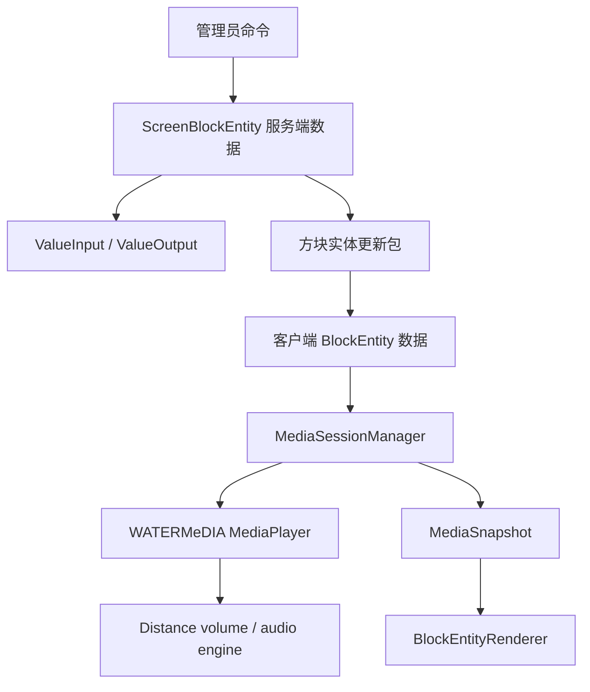
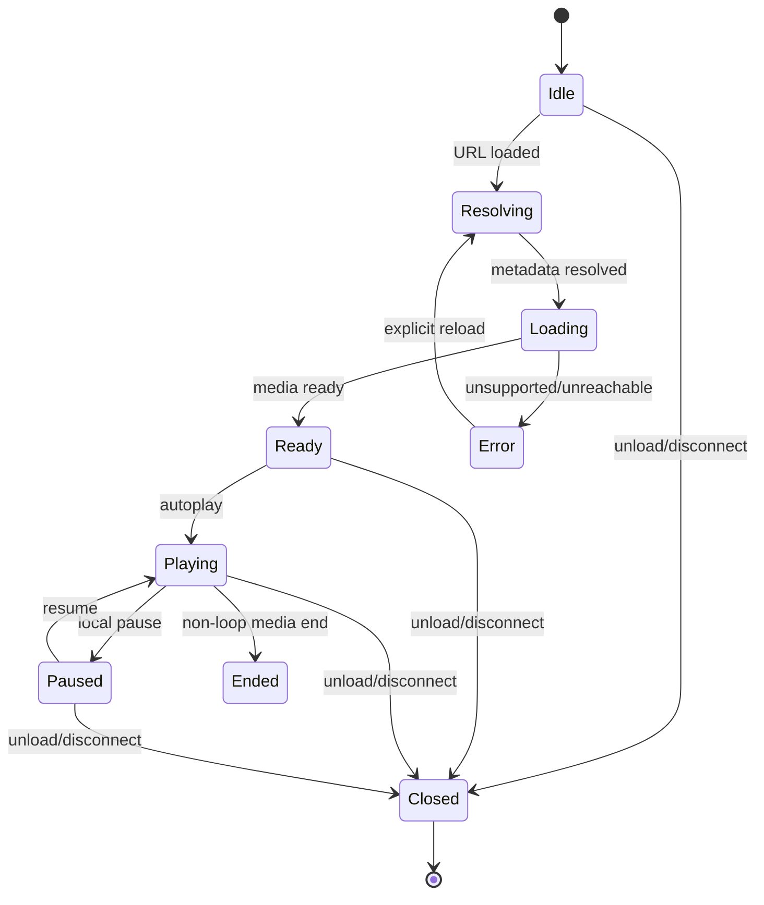

# 系统架构

## 分层



## Source Set 边界

### `src/main`

允许：

- 方块注册。
- 方块实体注册。
- URL、尺寸、音量等纯数据。
- 保存和加载。
- 管理员命令。
- 服务端校验。

禁止：

- `net.minecraft.client.*`
- WATERMeDIA 的客户端播放器。
- 纹理句柄。
- `BlockEntityRenderer`。
- `MediaSession`。
- 任何渲染状态类。

### `src/client`

用于：

- `ClientModInitializer`。
- `BlockEntityRenderer` 注册。
- 渲染状态与提交几何。
- 媒体会话管理。
- 客户端区块加载/卸载监听。
- 距离音量。
- 客户端资源清理。

## 核心对象

### `ScreenBlockEntity`

持久化权威数据。它不知道媒体是否正在解码，也不知道纹理句柄。

### `ScreenSettings`

纯记录对象，作为序列化和命令修改的边界。除 URL、尺寸、距离、九宫格位置、音量和循环设置外，还包含 `ScreenFitMode`、`rotationDegrees`、`hideFrame` 与 `refreshOnResume`。

### `ScreenFitGeometry`

无 Minecraft 客户端依赖的比例映射计算。它把屏幕尺寸、媒体尺寸和 `ScreenFitMode` 转换为四边形尺寸及 UV 范围；平铺模式会返回大于 `1.0` 的 UV，并使用 `DynamicTexture` 的重复采样。

### `OneScreenConfig`

服务端通用配置，读取 `config/onescreen.json` 中的最大渲染距离和声音传播距离。默认上限保持 `256`/`128`，硬上限为 `4096`/`1024`。指令和编辑 payload 使用该配置校验；编辑器打开时由服务端把当前上限传给客户端。

### `MediaSession`

每个屏幕在单个客户端上的媒体运行状态。只允许客户端创建。它负责播放状态、VOD seek、HLS 片段进度缓存以及可选的直播重连追帧。

### `MediaSessionManager`

按 `BlockPos` 或维度的稳定 key 管理会话。负责：

- create-or-reconcile。
- URL 去重。
- 并发上限。
- 距离音量。
- 关闭和重试。

### `ScreenRenderState`

每帧快照。只包含渲染所需的值；不直接修改方块实体。

### `ScreenRenderer`

读取渲染状态，计算变换，向 26.2 的提交队列提交四边形。

## 数据流

```text
命令执行（逻辑服务端）
  -> 验证权限与目标方块
  -> 验证 URL
  -> 修改 BlockEntity 字段
  -> setChanged()
  -> sendBlockUpdated()
  -> 跟踪该区块的客户端收到 BE 更新
  -> MediaSessionManager 比较 URL
  -> 关闭旧会话
  -> 异步创建新会话
  -> RenderState 读取媒体快照
  -> 提交屏幕四边形
```

## 客户端生命周期



## 并发原则

- 渲染线程只读取不可变或 volatile 快照。
- URL 解析和解码在 WATERMeDIA 的后台流程中完成。
- 所有客户端主线程状态修改通过客户端 tick 或事件回调完成。
- 对同一屏幕的会话替换必须串行。
- 关闭旧会话后再允许新会话输出声音。

## 大屏幕几何

第一版使用一个方块作为锚点：

- 方块中心为屏幕中心。
- `FACING` 决定屏幕平面和正面。
- `width` / `height` 以方块数计。
- 碰撞形状仍可保持普通单方块。
- `getRenderBoundingBox` 必须覆盖完整视觉面积。

## 可扩展点

后续版本可以增加：

- 任意角度旋转。
- 多屏无缝拼接。
- 客户端 GUI。
- 播放列表。
- 自定义音频距离模型。
- 服务端 URL allowlist。
- 多套屏幕模型。

这些扩展不能破坏第一版的 common/client 分离和会话生命周期。
