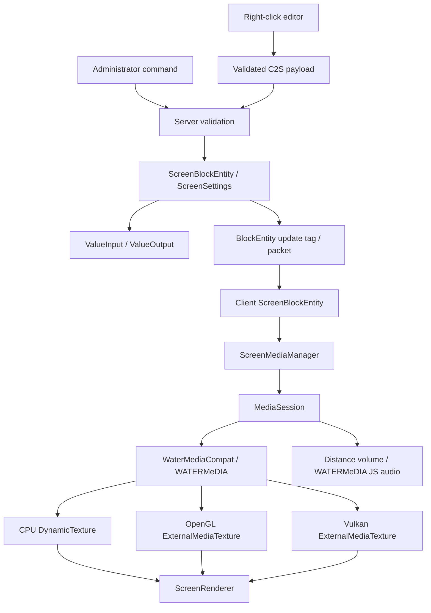

# System Architecture

## Overview

OneScreen uses server-authoritative configuration, client-local media, and Minecraft 26.2 render-state submission. The server stores and synchronizes screen settings but never downloads or decodes media. Each client creates and manages players, textures, and audio for its own graphics backend.



## Source-set boundaries

### `src/main`

Common and server-side logic:

- Blocks, block entities, and registries.
- `ScreenSettings`, URL validation, and pure geometry.
- Command tree and permissions.
- Editor, reload, and debug network payloads.
- `OneScreenConfig` server distance limits.
- Persistence and block-entity synchronization.

Prohibited:

- `net.minecraft.client.*`.
- Texture handles, players, or renderers.
- `MediaSession` or client media lifecycle objects.

### `src/client`

Client-only logic:

- `BlockEntityRenderer` registration and submission.
- Right-click editor UI.
- `ScreenMediaManager` and `MediaSession`.
- WATERMeDIA compatibility layer and CPU/OpenGL/Vulkan texture paths.
- Client chunk lifecycle and resource cleanup.
- Vulkan queue-synchronization Mixins.

## Core data objects

### `ScreenSettings`

An immutable record shared by commands, network validation, and persistence. Fields include:

- `url`
- `width` / `height`
- `renderDistance` / `audioDistance`
- `alignment` / `fitMode`
- `rotationDegrees` / `hideFrame`
- `volume` / `muted` / `loop`
- `refreshOnResume`

`ScreenBlockEntity` uses `with...` methods to create new records, preventing a partial field update from destroying unrelated settings. `loadAdditional` supplies defaults when old worlds lack newer fields.

### `ScreenBlockEntity`

Authoritative server data for one screen:

- Stores `ScreenSettings` and `loadRevision`.
- Persists through `saveAdditional` / `loadAdditional`.
- Uses `getUpdateTag` for players entering a chunk.
- Uses `getUpdatePacket` for runtime changes.
- Routes changes through `setSettings`, `setChanged`, and block updates.
- `reload()` increments a revision number and never manipulates a client player directly.

### `OneScreenConfig`

Reads maximum render and audio distances from `config/onescreen.json`. Defaults are `256` / `128`; hard caps are `4096` / `1024`. The server reads the file and sends active limits through the editor-open payload.

## Rendering architecture

### `ScreenRenderState`

Contains only the data needed for one frame:

- Facing, size, rotation, alignment, and fit mode.
- Current media texture, media width/height, and `MediaState`.
- Render distance and URL-presence flag.

`extractRenderState` may only read the block entity and a `MediaSnapshot`. It must not block, create players, download media, or mutate global state.

### `ScreenRenderer`

`ScreenRenderer` implements Minecraft 26.2 `BlockEntityRenderer<ScreenBlockEntity, ScreenRenderState>` and submits custom geometry through `submit` and `SubmitNodeCollector`:

1. Select the screen plane from `FACING`.
2. Apply in-plane rotation through `ScreenGeometry.right/up`.
3. Calculate alignment offsets through `ScreenAlignment`.
4. Map media aspect ratio to quad size and UV through `ScreenFitGeometry`.
5. Select the media texture; when absent, submit placeholder material only when debug mode is enabled.

The 26.2 target does not expose the old `getRenderBoundingBox` override used by earlier versions. Culling follows the current renderer contract; very large screens, long distances, and edge-on camera positions still require in-game verification. Do not copy an obsolete method signature.

### Six directions and the thin surface

- `FACING` covers horizontal directions plus `UP` and `DOWN`.
- The model, media quad, and narrow-edge textures must occupy the same thin surface.
- Up/down wide-face UVs use different basis vectors from horizontal faces and require separate regression tests.
- `hideFrame` hides only the static block model; the BlockEntityRenderer media quad and interaction area remain.
- Rotation affects only the screen plane and does not change the attached block face.

## Client networking and editor

### Opening the editor

After a right-click, the server validates distance and the target block entity, then sends `ScreenEditorOpenPayload`. The payload contains the current settings, configured distance limits, and current load revision.

### Saving settings

`ScreenSettingsUpdatePayload` submits:

- Position.
- URL.
- Size and distances.
- Alignment, fit mode, and rotation.
- Frame visibility, looping, and live-stream refresh.

The server repeats permission, edit-distance, URL, numeric-range, and configuration-limit validation before writing the new settings and broadcasting a block-entity update.

### Reload

`ScreenReloadPayload` contains only the block position. The server verifies permission, the target block entity, edit distance, and a non-empty URL, then calls `reload()`. The client manager observes the changed revision, closes the old session, and recreates the same URL.

### Debug state

`/screen config debug on|off` changes server debug state and broadcasts `ScreenDebugStatePayload`. The client uses that state to decide whether an empty screen should submit placeholder material.

## Media-session architecture

### `ScreenMediaManager`

Manages `MediaSession` instances by a `ScreenKey` containing dimension and block position:

- `track(BlockEntity)` registers or updates a screen.
- A URL or `loadRevision` change replaces the session.
- A client retains at most eight active sessions; excess screens retry later.
- Every tick updates player distance, audio gain, video LOD, and pause state.
- Chunk unload, disconnect, and dimension changes close sessions.

### `MediaSession`

Client state machine for one screen:

```text
RESOLVING -> LOADING -> PLAYING
                    \-> PAUSED
                    \-> ENDED
Any state ----------> ERROR / IDLE
```

Responsibilities:

- Create the MRL, engines, and player.
- Distinguish images, video, audio, and HLS live streams.
- Register and manage CPU/GPU textures.
- Apply volume, mute, looping, and LOD.
- Handle VOD seeking and live segment progress.
- Reopen a live stream when configured after resume or settings changes.
- Release textures, players, and engines in the correct order.

All Minecraft object access occurs on the client thread. Background callbacks only update thread-safe frame counters or metadata caches.

## Three media texture paths

### CPU fallback

```text
WATERMeDIA AWTEngine
  -> BufferedImage packed ARGB
  -> MediaTextureUploader
  -> NativeImage
  -> DynamicTexture
  -> ScreenRenderer
```

- Copy only when the frame sequence changes.
- Use a native-order `IntBuffer` to batch pixel writes.
- Fall back automatically when GPU initialization or backend adaptation fails.
- Still involves GPU-to-CPU readback and CPU-to-GPU upload; 4K/8K performance is not guaranteed.

### OpenGL GPU

```text
WATERMeDIA GLEngine
  -> current GL texture ID
  -> ExternalMediaTexture
  -> Minecraft GlTextureView
  -> ScreenRenderer
```

The wrapper reads the current texture ID during drawing, preventing Minecraft from staying bound to an old handle after WATERMeDIA rotates textures.

### Vulkan GPU

```text
Minecraft VulkanDevice
  -> WaterMediaVulkanContext
  -> WATERMeDIA VKContext proxy
  -> WATERMeDIA VKEngine
  -> VkImageView
  -> WaterMediaVulkanView
  -> Minecraft texture binding
```

Correctness depends on a shared graphics queue and one queue lock:

- `VulkanQueueSynchronization` provides a lock keyed by the native `VkQueue`.
- `VulkanQueueSubmissionMixin` locks `vkQueueSubmit2KHR`.
- `VulkanQueueMixin` locks `vkQueueWaitIdle`.
- `VulkanGpuSurfaceMixin` locks `vkQueuePresentKHR`.

Do not switch back to a separate compute/transfer queue unless cross-queue semaphores, barriers, and consumer visibility are fully implemented and tested.

## Resolution and LOD

- OneScreen does not impose a fixed video pixel limit.
- `LOD=MAX` allows WATERMeDIA to use the source size.
- `VideoLod` selects `MAX/CLOSE/NEAR/FAR/FAR_AWAY` from distance ratio.
- A `0.05` hysteresis band avoids changing tiers while a player walks near a boundary.
- `format=GPU/CPU` describes texture routing; `hardwareAccel=true/false` describes decoding. They are independent measurements.

## Concurrency and ownership

- Server settings are modified on the logical server thread.
- Client player, world, and texture state are modified on the client thread.
- WATERMeDIA background decode threads must not call Minecraft APIs.
- WATERMeDIA owns `VkImage`, `VkDeviceMemory`, `VkImageView`, and its retirement queue.
- OneScreen owns only Minecraft-side wrapper objects and must not destroy WATERMeDIA resources during unregister.
- Closing a session must stop new frames from entering the renderer before releasing players and engines.

## Data flow

```text
Command or editor save
  -> server validation
  -> mutate ScreenBlockEntity
  -> setChanged + block update
  -> client receives new ScreenSettings
  -> ScreenMediaManager compares URL/loadRevision
  -> close old MediaSession
  -> asynchronously create new MediaSession
  -> select CPU/OpenGL/Vulkan texture path
  -> ScreenRenderState reads snapshot
  -> ScreenRenderer submits media quad
```

## Extension points

Prefer adding future functionality at these boundaries:

- New fit algorithms: extend `ScreenFitMode` and `ScreenFitGeometry`.
- New media capabilities: extend the `WaterMediaCompat` wrapper instead of scattering reflection.
- New persisted fields: extend `ScreenSettings` and payloads while preserving old-world defaults.
- Multi-screen layouts: create an independent layout/group model rather than assuming single-screen coordinates.
- New graphics backends: implement the corresponding `ExternalMediaTexture` view/adapter and verify ownership and queue contracts.
- URL security policy: add a server-side allowlist; client-side validation alone is insufficient.

Return to the [English documentation index](README.md).