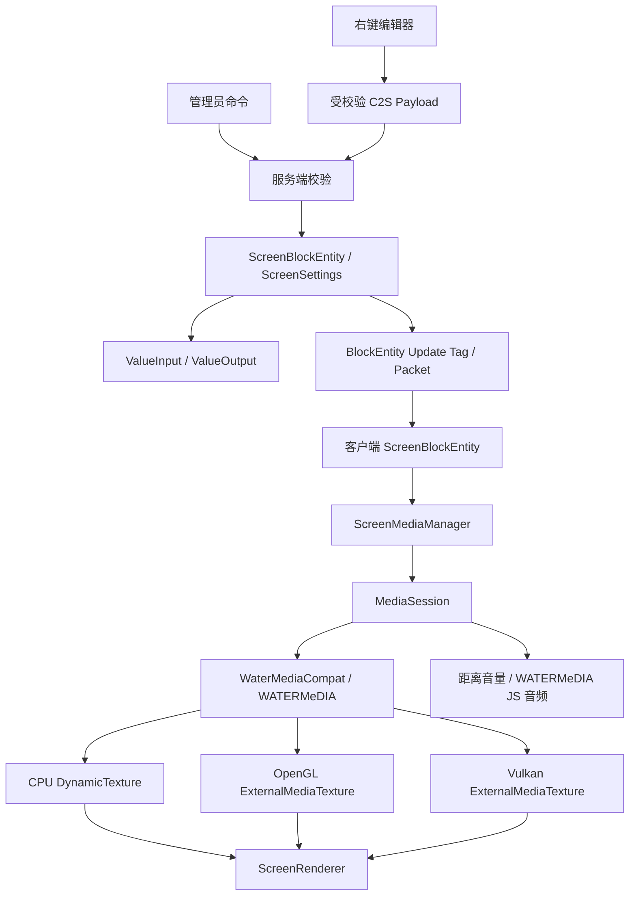

# 系统架构

## 总览

OneScreen 采用“服务端权威数据 + 客户端本地媒体 + 26.2 render-state 提交”的结构。服务端只保存和同步屏幕配置，不下载或解码媒体；每个客户端为自己的图形后端创建并管理播放器、纹理和声音。



## Source Set 边界

### `src/main`

公共和服务端逻辑：

- 方块、BlockEntity 和注册表。
- `ScreenSettings`、URL 校验、纯几何计算。
- 命令树和权限检查。
- 编辑器/刷新/debug 网络 payload。
- `OneScreenConfig` 服务端距离上限。
- 持久化和方块实体同步。

禁止引用：

- `net.minecraft.client.*`。
- 纹理句柄、播放器和渲染器。
- `MediaSession` 或任何客户端媒体生命周期对象。

### `src/client`

客户端专属逻辑：

- `BlockEntityRenderer` 注册和渲染提交。
- 右键编辑界面。
- `ScreenMediaManager` 与 `MediaSession`。
- WATERMeDIA 兼容层、CPU/OpenGL/Vulkan 纹理路径。
- 客户端区块生命周期和资源清理。
- Vulkan 队列同步 Mixin。

## 核心数据对象

### `ScreenSettings`

不可变记录，是命令、网络校验和持久化的共同边界。字段包括：

- `url`
- `width` / `height`
- `renderDistance` / `audioDistance`
- `alignment` / `fitMode`
- `rotationDegrees` / `hideFrame`
- `volume` / `muted` / `loop`
- `refreshOnResume`

`ScreenBlockEntity` 通过 `with...` 方法生成新记录，避免部分字段更新时破坏其他设置。旧存档缺失字段时由 `loadAdditional` 填充默认值。

### `ScreenBlockEntity`

屏幕服务端权威数据：

- 保存 `ScreenSettings` 和 `loadRevision`。
- `saveAdditional` / `loadAdditional` 负责持久化。
- `getUpdateTag` 同步后进入区块的完整状态。
- `getUpdatePacket` 同步运行时修改。
- `setSettings`、`setChanged` 和 block update 构成统一修改入口。
- `reload()` 只递增修订号，不直接操作客户端播放器。

### `OneScreenConfig`

读取 `config/onescreen.json` 的最大渲染距离和声音传播距离。默认 `256`/`128`，硬上限 `4096`/`1024`。配置由服务端读取，并通过编辑器打开 payload 把当前有效上限传给客户端。

## 渲染架构

### `ScreenRenderState`

每帧只保存渲染需要的数据：

- 朝向、尺寸、旋转、九宫格位置和适配模式。
- 当前媒体纹理、媒体宽高和 `MediaState`。
- 渲染距离和是否有 URL。

`extractRenderState` 只读取 BlockEntity 和 `MediaSnapshot`，不得阻塞、创建播放器、下载媒体或修改全局状态。

### `ScreenRenderer`

`ScreenRenderer` 实现 26.2 的 `BlockEntityRenderer<ScreenBlockEntity, ScreenRenderState>`，使用 `submit` + `SubmitNodeCollector` 提交自定义几何：

1. 根据 `FACING` 选择屏幕平面。
2. 用 `ScreenGeometry.right/up` 应用平面内旋转。
3. 用 `ScreenAlignment` 计算九宫格偏移。
4. 用 `ScreenFitGeometry` 把媒体比例映射到四边形尺寸和 UV。
5. 选择媒体纹理；无纹理时仅在 debug 开启时提交占位材质。

26.2 当前目标没有可供本实现覆盖的旧版 `getRenderBoundingBox` 方法。渲染剔除继续依赖该版本 renderer 契约；超大屏幕、极远距离和摄像机贴近边界时的剔除仍需实机验证，不能复制旧版本签名。

### 六向与薄面

- `FACING` 包含水平四向与 `UP`/`DOWN`。
- 模型、媒体面和窄边贴图必须落在同一薄面。
- `UP`/`DOWN` 的宽面 UV 与水平面使用不同基向量，必须单独回归。
- `hideFrame` 只隐藏静态 block model，不删除 BlockEntityRenderer 的媒体面或点击区域。
- 当前旋转只作用于屏幕所在平面，不改变方块的放置朝向。

## 客户端网络与编辑器

### 打开编辑器

服务端收到玩家右键后，验证距离和目标方块，再发送 `ScreenEditorOpenPayload`。payload 包含当前设置、服务端配置上限和当前加载修订。

### 保存设置

`ScreenSettingsUpdatePayload` 从客户端提交：

- 坐标。
- URL。
- 尺寸、距离、九宫格位置、适配、旋转。
- 隐藏画框、循环和直播追帧。

服务端重新执行权限、编辑距离、URL、数值范围和配置上限校验，然后写入 BlockEntity 并同步所有跟踪客户端。

### 刷新

`ScreenReloadPayload` 只携带方块坐标。服务端验证权限、目标方块、编辑距离和非空 URL 后调用 `reload()`，递增 `loadRevision`。客户端管理器观察到修订变化后关闭旧会话并重建同一 URL。

### Debug 状态

`/screen config debug on|off` 修改服务端 debug 设置，并通过 `ScreenDebugStatePayload` 广播给所有客户端。无媒体时是否显示占位材质由客户端 debug 状态决定。

## 媒体会话架构

### `ScreenMediaManager`

按维度和方块坐标组成的 `ScreenKey` 管理 `MediaSession`：

- `track(BlockEntity)` 注册或更新屏幕。
- URL 或 `loadRevision` 变化时替换会话。
- 单个客户端最多保留 8 个活动会话，超出后延迟重试。
- 每 tick 更新玩家距离、距离音量、视频 LOD 和暂停状态。
- 区块卸载、断线和维度切换时关闭会话。

### `MediaSession`

单个屏幕的客户端媒体状态机：

```text
RESOLVING -> LOADING -> PLAYING
                    \-> PAUSED
                    \-> ENDED
任意状态 -----------> ERROR / IDLE
```

主要职责：

- 创建 MRL、引擎和播放器。
- 区分图片、视频、音频和 HLS 直播。
- 管理 CPU/GPU 纹理注册。
- 应用音量、静音、循环和 LOD。
- 处理 VOD seek 与直播片段进度。
- 在暂停恢复或配置更新后按设置重连直播。
- 关闭时按纹理、播放器、引擎顺序释放资源。

`MediaSession` 的所有 Minecraft 对象操作都在客户端线程；后台回调只更新线程安全的帧序号或元数据缓存。

## 三条媒体纹理路径

### CPU 回退

```text
WATERMeDIA AWTEngine
  -> BufferedImage packed ARGB
  -> MediaTextureUploader
  -> NativeImage
  -> DynamicTexture
  -> ScreenRenderer
```

- 只在帧序号变化时复制最新帧。
- 使用 native-order `IntBuffer` 批量写入像素。
- GPU 初始化或后端适配失败时自动回退。
- 仍包含 GPU 到 CPU 回读和 CPU 到 GPU 上传，不承诺 4K/8K 性能。

### OpenGL GPU

```text
WATERMeDIA GLEngine
  -> 当前 GL texture id
  -> ExternalMediaTexture
  -> Minecraft GlTextureView
  -> ScreenRenderer
```

包装器在绘制时动态读取当前 texture id，避免 WATERMeDIA 轮换纹理后继续绑定旧句柄。

### Vulkan GPU

```text
Minecraft VulkanDevice
  -> WaterMediaVulkanContext
  -> WATERMeDIA VKContext proxy
  -> WATERMeDIA VKEngine
  -> VkImageView
  -> WaterMediaVulkanView
  -> Minecraft texture binding
```

Vulkan 的正确性依赖共享 graphics queue 和统一队列锁：

- `VulkanQueueSynchronization` 按原生 `VkQueue` 句柄分配锁。
- `VulkanQueueSubmissionMixin` 锁住 `vkQueueSubmit2KHR`。
- `VulkanQueueMixin` 锁住 `vkQueueWaitIdle`。
- `VulkanGpuSurfaceMixin` 锁住 `vkQueuePresentKHR`。

不得改回独立 compute/transfer queue，除非同时实现并验证跨队列 semaphore、资源屏障和消费者可见性。

## 分辨率与 LOD

- OneScreen 不设置固定视频像素上限。
- `LOD=MAX` 允许 WATERMeDIA 使用源尺寸。
- `VideoLod` 按距离比例选择 `MAX/CLOSE/NEAR/FAR/FAR_AWAY`。
- 阈值带 `0.05` 迟滞，避免玩家在边界来回移动时逐帧改档。
- `format=GPU/CPU` 描述纹理路径；`hardwareAccel=true/false` 描述解码路径，两者不能混为一谈。

## 并发与所有权

- 服务端配置修改串行发生在逻辑服务端线程。
- 客户端玩家、世界和纹理状态只在客户端线程修改。
- WATERMeDIA 后台解码线程不能直接调用 Minecraft API。
- WATERMeDIA 拥有 `VkImage`、`VkDeviceMemory`、`VkImageView` 与自己的退休队列。
- OneScreen 只拥有 Minecraft 侧纹理包装对象，并在注销时避免销毁 WATERMeDIA 资源。
- 关闭会话必须先停止新帧进入渲染器，再释放播放器和引擎。

## 数据流

```text
命令或编辑器保存
  -> 服务端校验
  -> 修改 ScreenBlockEntity
  -> setChanged + block update
  -> 客户端收到新 ScreenSettings
  -> ScreenMediaManager 比较 URL/loadRevision
  -> 关闭旧 MediaSession
  -> 异步创建新 MediaSession
  -> 选择 CPU/OpenGL/Vulkan 纹理路径
  -> ScreenRenderState 读取快照
  -> ScreenRenderer 提交媒体四边形
```

## 可扩展点

后续功能应优先增加在以下边界：

- 新画面适配算法：扩展 `ScreenFitMode` 和 `ScreenFitGeometry`。
- 新媒体能力：扩展 `WaterMediaCompat` 包装接口，不在业务类散落反射。
- 新持久化字段：扩展 `ScreenSettings` 与 payload，同时保留旧存档默认值。
- 多屏拼接：新增独立的布局/分组模型，不复用单屏 BlockEntity 的隐式坐标假设。
- 新图形后端：实现 `ExternalMediaTexture` 的对应 view/适配器，并验证纹理所有权与队列契约。
- URL 安全策略：在服务端校验层增加 allowlist；不能只靠客户端校验。